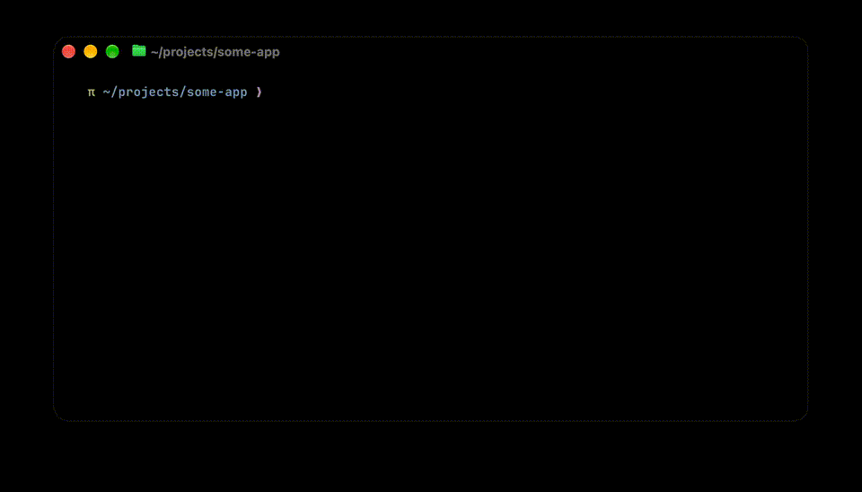

# inmate

Run Claude Code in an Apple container VM that sees only your project directory.

```sh
cd ~/projects/some-app
inmate claude
```



`inmate` uses Apple's [`container`](https://github.com/apple/container), which runs each
container in its own lightweight VM. The VM is given one host directory: the one you ran
`inmate` from. It cannot see the rest of your home directory, Keychain, SSH keys, or host
Claude config. If you run `inmate` from `~` itself, the VM sees your whole home directory,
including `~/.ssh` and `~/.claude`. It does have normal network access; see
[Known limitations](#known-limitations).

### Motivation

I built `inmate` after trying Claude Code's `blockReadsOutsideWorkingDirectories` permissions setting.
It blocks a high volume of actions Claude legitimately needs to function smoothly.
It occasionally blocks reads that I consider dangerous.
With so many actions to approve, I would sooner or later approve something bad on accident.
`inmate` makes it so I don't have to make constant judgements about whether my files will be safe.

## Requirements

- Apple silicon Mac running macOS 26 or later
- `brew install container`
- A Claude Pro, Max, Team, or Enterprise plan
- Optional: a GitHub fine-grained personal access token, for GitHub access from the VM
- Optional: Xcode and `brew install socat`, for the [Xcode bridge](#xcode)

## Install

```sh
git clone <this repo> ~/projects/inmate
ln -s ~/projects/inmate/bin/inmate ~/.local/bin/inmate
inmate setup
```

`inmate setup` does four things:

1. Starts the `container` service.
2. Builds the image with the current Claude Code, `gh` and `uv` releases.
3. Logs you in to Claude if no token is stored, via a browser URL and a code.
4. Asks for a GitHub token if none is stored. Press Enter to skip.

Both tokens live in the macOS Keychain. Run `inmate setup` again to update Claude Code,
`gh` and `uv`, which are all fetched at build time.
To log in again or replace a token, delete the Keychain item first:

```sh
security delete-generic-password -s inmate -a claude-code-oauth-token
security delete-generic-password -s inmate -a github-token
```

Everything after `inmate` is passed through untouched:

```sh
inmate claude                 # Claude Code in the VM
inmate claude --continue      # Claude's own flags work as usual
inmate bash                   # a shell in the VM
```

If no Claude token is stored, `inmate` refuses to start and tells you to run
`inmate setup`. Claude never shows its own login screen inside the VM.

The VM gets 4 CPUs and up to 8 GB of memory by default. Memory is a ceiling, not a
reservation: the host only commits what the VM actually uses. Override either with an
environment variable:

```sh
INMATE_MEMORY=4G inmate claude
```

`INMATE_CPUS` works the same way. Memory takes a `K`, `M`, `G`, or `T` suffix.

To forward other host environment variables into the VM, list them in `INMATE_ENV`:

```sh
INMATE_ENV="MODAL_PROXY_API_KEY MODAL_TOKEN_ID MODAL_TOKEN_SECRET" inmate claude
```

Anything forwarded is readable by everything running in the VM, like the tokens.

## Shadow directories

Build output such as a Python virtualenv contains Linux binaries inside the VM and Mac
binaries on the host. The two can't share a directory: inside the VM each is a mount of
`<project>/.inmate/shadow/<dir>`, while on the Mac the project's own `<dir>` is untouched.
The shadow copies live under `.inmate/`, so git ignores them.

Set `INMATE_SHADOW_DIRS` to a space-separated list to change which directories are shadowed:

```sh
INMATE_SHADOW_DIRS=".venv node_modules" inmate claude
```

The image ships `uv` and `uvx` for Python projects. The uv cache lives on the VM's
ephemeral disk, so it does not persist between runs and never duplicates the venv under
`.inmate/`. Managed Python installs do persist, under `.inmate/home/.local/share/uv`.

There is no system Python. `python` and `python3` are shims for `uv run python`, so in a
uv project they use the project's venv, and elsewhere a uv-managed Python, downloaded on
first use. There is no `pip`; use `uv add` or `uv pip`.

## GitHub

Inside the VM, `gh` and HTTPS git remotes use the token from `inmate setup`. The VM has
no SSH keys, so git rewrites GitHub SSH remotes (`git@github.com:` and
`ssh://git@github.com/`) to HTTPS. The project's `.git/config` is untouched, so the
remote stays SSH on your Mac. SSH remotes on other hosts do not work.

Commits made in the VM carry your host identity. `inmate` reads `user.name` and
`user.email` from `git config` on the Mac and forwards them as `GIT_AUTHOR_*` and
`GIT_COMMITTER_*`. If those variables are already set in your shell, they win.

Anything running in the VM can read the token, so scope it to the repos you work on:

1. On GitHub, open Settings → Developer settings → Personal access tokens → Fine-grained
   tokens.
2. Under Repository access, choose "Only select repositories" and pick your repos.
3. Under Permissions, grant Contents: Read and write. Add Pull requests and Issues if
   you want `gh pr` and `gh issue`.
4. Run `inmate setup` and paste the token when asked.

## MCP servers on the Mac

From inside the VM, the Mac is the network gateway, so HTTP and SSE MCP servers running
on the Mac are reachable.

1. Find the gateway address. It differs between Macs, so look it up rather than
   copying one:

   ```sh
   container network inspect default    # status.ipv4Gateway, e.g. 192.168.64.1
   ```

2. Point the server at it in the project's `.mcp.json`:

   ```json
   {
     "mcpServers": {
       "example": { "type": "http", "url": "http://192.168.64.1:3000/mcp" }
     }
   }
   ```

A stdio server is a child process that Claude would have to start on the Mac, which it
can't do from the VM. It needs a bridge on the Mac, as `inmate` sets up for
[Xcode](#xcode).

## Xcode

The VM is Linux, so it can't build or run Xcode itself. It can use the MCP server that
Xcode runs on the Mac, `xcrun mcpbridge`, through a bridge that `inmate` starts:

```sh
INMATE_XCODE_BRIDGE=1 inmate claude
```

Claude then has an `Xcode` MCP server. Xcode must be running on the Mac.

Before Claude can use Xcode's tools, it has to open or create a project, and Xcode asks
on the Mac whether to allow it. Until then, the tools fail with "This agent isn't
approved". Xcode treats the program that starts `xcrun mcpbridge` as the agent, so it
sees `socat`, not Claude. Homebrew's `socat` isn't signed by a developer, so Xcode treats
it as an unknown agent and allows it for at most 24 hours. After that, it asks again.

The first time, install `socat` on the Mac and rebuild the image, which also ships `socat`:

```sh
brew install socat
inmate setup
```

If the macOS firewall is on, it asks whether `socat1` may accept incoming connections.
Allow it, or the VM's connections are silently dropped and Claude reports
`CONNECTION_CLOSED`. `socat1` is the program Homebrew's `socat` links to. The approval
covers every use of `socat` on the Mac, not just this bridge, and it may be asked again
after `brew upgrade socat`. To approve it from the command line:

```sh
fw=/usr/libexec/ApplicationFirewall/socketfilterfw
sudo $fw --add "$(realpath "$(command -v socat)")"
sudo $fw --unblockapp "$(realpath "$(command -v socat)")"
```

How it works:

- **On the Mac,** `socat` listens on the first free port from 8765 and starts a new
  `xcrun mcpbridge` for each connection. It accepts connections only from the container
  subnet, which it reads from `container network inspect default`. Each session started
  with the flag gets its own bridge, which stops when that session exits.
- **In the VM,** the entrypoint registers `Xcode` as a user-scoped stdio server that runs
  `socat` to connect to the bridge. If you already have a user-scoped server named
  `Xcode`, it is kept and the bridge is not registered. If the project's `.mcp.json` or
  a local-scoped server defines `Xcode`, `inmate` exits instead, since that entry would
  take precedence over the bridge. Without the flag, a managed setting blocks the
  server, so Claude doesn't start it.

Set `INMATE_XCODE_BRIDGE_PORT` to change the first port tried. `inmate` tries it and the
next 19.

The bridge has no authentication, and Xcode's approval isn't tied to one VM. Anything on
the container subnet can use it, including `inmate` VMs started without the flag and any
other containers. Xcode's tools aren't limited to the mounted project either: they can
see every project open in Xcode. Through the bridge, code in the VM can run code on your
Mac, for example by adding a Run Script build phase to the project and asking Xcode to
build. That is a deliberate hole in the isolation; leave the flag off when you don't
need it.

## Claude settings

The image carries two kinds of Claude Code settings.

**Managed settings** (`image/managed-settings.d/`) are policy. They outrank every project
and user setting, so Claude's own settings can't override them. They aren't
tamper-proof: code in the VM runs as root and can change them, but every run starts
again from the image. `10-inmate-privacy.json` turns off telemetry, error reporting,
feedback, and auto-updates. `50-inmate-xcode-off.json` blocks the [Xcode](#xcode) server
unless the bridge is on.

**User defaults** (`image/defaults.d/`) are opinionated examples, meant to be edited or
deleted before you build. The `*.json` files are merged in name order into one user
settings file, which is copied to `<project>/.inmate/home/.claude/settings.json` the
first time you run `inmate` in a project and never again. The shipped examples set:

- `10-inmate-models.json`: Opus, xhigh effort, high effort for Fable
- `20-inmate-plugins.json`: two official plugins, the learning output style and the PR
  review toolkit
- `30-inmate-statusline.json`: the `inmate` status line
- `90-inmate-misc.json`: vim editor mode, no commit or PR attribution

To change the defaults, edit or remove the files and run `inmate setup`. To reseed a
project, delete its `settings.json`.

## Cleaning up

Each run creates a container that is removed when the command exits. If a terminal dies
mid-session, the container can be left behind:

```sh
container ls -a                 # names start with inmate-
container rm -f <name>
```

`inmate setup` starts the `container` background service, which keeps running after you
exit. To stop it:

```sh
container system stop
```

The next `inmate` run starts it again.

`container` keeps a build cache in a separate builder VM that grows with every image
build and is never trimmed. Check with `container system df` and reclaim the space with:

```sh
container builder delete --force
```

The next `inmate setup` recreates it.

## How it works

- **Same paths.** The project is mounted at the same absolute path inside the VM, so
  file paths match what you see on your Mac. The only exception is the
  [shadow directories](#shadow-directories), which point at `.inmate/shadow/` instead.
- **Fresh VM, persistent state.** Each run starts a new VM. `HOME` is
  `<project>/.inmate/home`, so Claude's config and history persist per project.
  Git ignores `.inmate/` without changes to your own ignore files.
- **Root inside the VM.** `container` mounts have no UID mapping, so every file appears
  root-owned inside the VM. Files Claude creates are owned by you on the Mac.

## Known limitations

- **The isolation is for files, not the network.** The VM has full outbound access: the
  internet, your local network, and any service on the Mac that listens on all
  interfaces. Services bound to `127.0.0.1` are not reachable.
- **The tokens are readable inside the VM.** Anything running in the VM can read the
  Claude and GitHub tokens, and anything listed in `INMATE_ENV`, from the environment.
- **Claude can still damage the project**, including `.git`. Commit before long
  unattended sessions.
- **Empty shadow directories appear on the Mac.** Mounting creates them in the project
  if they don't exist. They stay empty on the host; the contents live in `.inmate/shadow/`.
- **No Xcode toolchain.** The VM is Linux. Claude can use Xcode on the Mac only through
  its MCP tools; see [Xcode](#xcode).
- **No image paste.** The VM can't see your clipboard.
